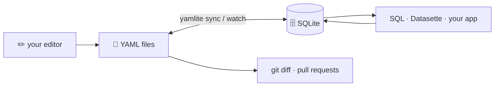

<p align="center">
  
</p>

<h1 align="center">YAMLite</h1>

<p align="center">
  <strong>Your YAML files, queryable with SQL.<br>Your SQLite database, reviewable in git.</strong>
</p>

<p align="center">
  <a href="https://github.com/yamlite-hq/yamlite/actions/workflows/ci.yml"></a>
  <a href="https://www.npmjs.com/package/yamlite"></a>
  
  <a href="LICENSE"></a>
</p>

---

YAMLite keeps a folder of YAML files and a local SQLite database in sync, in both directions, continuously. Edit a file in your editor and the row changes. Run an `UPDATE` and the file changes — with your comments still in place.

<p align="center">
  
</p>

## Why

YAML is great for data humans write: readable, diffable, comment-friendly, git-native. It is terrible to query. SQLite is the opposite. YAMLite lets you keep both without choosing:

- **Hand-written data, SQL queries** — tasks, notes, contacts, configs, fixtures. Keep editing YAML; ask questions with SQL, Datasette, or any SQLite tool.
- **App-written data, git history** — let a script or app write to SQLite and get every change as a reviewable YAML diff.



## Features

- **Two-way, continuous sync** — `yamlite watch` reacts to file saves and to commits from any process writing the database.
- **One schema file** — `yamlite init` writes `yamlite.yaml` from your data. Commit it next to your YAML: it pins every column's type, and YAMLite keeps the database matching it.
- **Comment-preserving writes** — only changed fields are rewritten; comments, key order and flow style (`[a, b]`) survive.
- **Typed columns** — `true` → `BOOLEAN`, `1` → `INTEGER`, `1.5` → `REAL`, maps/lists → `JSON`, inferred from your data.
- **Safe by default** — broken YAML is never overwritten or treated as deleted, mass deletions are refused, and the losing side of a conflict is always backed up.
- **Rebuildable** — the database is a cache. Delete it, run `sync`, and it comes back from YAML.
- **CLI and library** — use the `yamlite` command or `import { open } from "yamlite"`.
- **No native dependencies** — built on Node's built-in `node:sqlite`.

## Installation

Requires Node.js 24.16 or later.

```bash
npm install -g yamlite
# or
pnpm add -g yamlite
```

Or run it without installing:

```bash
npx yamlite status ./notes
```

## Quick Start

Each entry directly under the root becomes a table:

```
notes/
├── tasks/              # directory → one record per file, key = path (subfolders too)
│   ├── buy-milk.yaml
│   └── write-blog.yaml
└── people.yaml         # file → a list of records, key = `id`
```

```yaml
# tasks/buy-milk.yaml
title: 牛乳を買う
done: false
```

```bash
yamlite init notes # infer yamlite.yaml from your files
yamlite sync notes
yamlite query "select title from tasks where done = 0" notes
```

## Documentation

Full documentation: <https://yamlite.com/docs/>

## License

[MIT](LICENSE)
