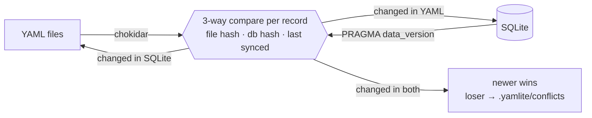

## How it works

For every record, YAMLite compares the current file hash and row hash with the hashes recorded at the last sync (stored in the `_yamlite_state` table). Only the side that changed is propagated, and each side is re-read after writing, so YAMLite never echoes its own writes back or loops. Apart from three bookkeeping tables (`_yamlite_state`, `_yamlite_columns` and `_yamlite_views`) and the views you declare under `expand`, nothing is added to your database — no triggers, no change log.

## Safety

YAMLite is built so that a sync never silently loses data:

- **Unreadable files are untouchable.** A YAML file with a syntax error, several documents, or the wrong top-level shape is never overwritten and never treated as a deletion: a record file is skipped, and a broken list file stops its table with an error. A subfolder that can't be read and a symlink whose target is gone also stop their table, since they may hold records. Fix it and the next sync picks it up.
- **Mass deletions are refused.** A sync that would delete more than `max(10, 50%)` of a table, or empty a table that had several records, stops unless you pass `--force`. A missing folder or a dropped table with previously synced records is an error, not a wipe.
- **Conflicts keep both sides.** If a record changed in YAML and in the database, the newer change wins and the other version is saved to `.yamlite/conflicts/<table>/`. The file's modification time is compared with the database's last write (any row, in any table), so the database wins whenever it was written after the file was saved. Each backup starts with a `# yamlite: {...}` comment line that records the table, the key, which side won and when.
- **Concurrent edits are detected.** Files are rewritten atomically and only if they are unchanged since they were read; database writes run in a transaction.
- **One writer at a time.** A lock in `.yamlite/` keeps two `sync`/`watch` processes from running together (`status` is always allowed).
