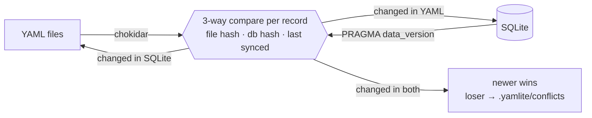

## 仕組み

YAMLite は、レコードごとに、現在のファイルのハッシュと行のハッシュを、前回の同期時に記録したハッシュ(`_yamlite_state` テーブルに保存)と比べます。変更があった側だけを反映し、書き込んだあとは両側を読み直します。そのため、自分の書き込みが跳ね返ってくることも、同期が堂々巡りになることもありません。管理用の 3 つのテーブル(`_yamlite_state`、`_yamlite_columns`、`_yamlite_views`)と、`expand` で宣言したビューを除いて、データベースには何も追加しません。トリガーも変更ログもありません。

## 安全性

YAMLite は、同期でデータが黙って失われないように作られています。

- **読めないファイルには手を付けません。** 構文エラーがある YAML ファイル、複数のドキュメントを含むファイル、トップレベルの形が違うファイルは、上書きも削除扱いもしません。レコードのファイルはスキップし、壊れたリストファイルはエラーを出してそのテーブルの同期を止めます。読み取れないサブフォルダーと、リンク先がなくなったシンボリックリンクも、レコードを含んでいる可能性があるため、そのテーブルの同期を止めます。直せば、次の同期で反映されます。
- **大量削除は拒否します。** テーブルの `max(10, 50%)` を超える削除になる同期や、複数のレコードがあったテーブルを空にする同期は、`--force` を付けない限り止まります。フォルダーがない場合や、同期済みのレコードがあるテーブルが削除された場合は、全消去ではなくエラーになります。
- **衝突しても両方を残します。** 同じレコードが YAML とデータベースの両方で変更されたときは、新しいほうの変更を採用し、もう一方は `.yamlite/conflicts/<table>/` に保存します。ファイルの更新時刻と、データベースの最終書き込み時刻(どのテーブルのどの行でも)を比べるので、ファイルの保存後にデータベースへ書き込んでいれば、データベースが採用されます。バックアップの先頭には `# yamlite: {...}` というコメント行があり、テーブル、キー、どちらを採用したか、その時刻を記録しています。
- **同時編集を検出します。** ファイルは、読み込み後に変更されていない場合に限り、アトミックに書き換えます。データベースへの書き込みはトランザクション内で実行します。
- **書き込めるのは同時に 1 つだけです。** `.yamlite/` 内のロックにより、`sync` と `watch` のプロセスは同時に動きません(`status` は常に実行できます)。
